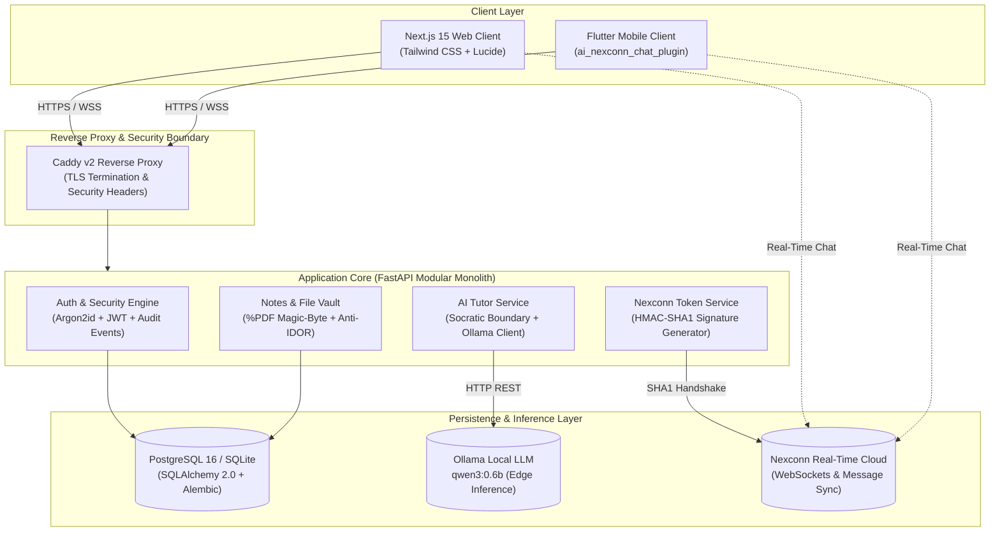

# 🎓 StudySphere — Hackathon Submission & Pitch Documentation

> **Tagline:** The Privacy-First, Zero-Budget Collaborative Learning Ecosystem with On-Device AI Tutoring and Real-Time Study Channels.

---

## 📌 Executive Summary & Pitch Hook

Modern students juggle disjointed tools: Discord for messaging (noisy, distracting), Google Drive for notes (disconnected from discussion), and expensive cloud AI subscriptions like ChatGPT (\$20/month) that harvest personal data.

**StudySphere solves this fragmented workflow.** It is an all-in-one, privacy-first collaborative learning platform that unites **real-time study groups**, **on-device local AI tutoring**, and **tamper-proof private note sharing** into a unified web and mobile experience. Built on a zero-budget architecture with enterprise-grade security (Argon2id, anti-BOLA/IDOR authorization, magic-byte inspection), StudySphere delivers high-performance education without cloud API costs or privacy trade-offs.

---

## 💡 The Problem & The Market Opportunity

| Problem | Student Impact | StudySphere Solution |
| :--- | :--- | :--- |
| **Fragmented Study Workflows** | Switching between 4+ apps causes cognitive fatigue and broken context. | Centralized hub combining live chat, subject channels, notes, and AI tutoring. |
| **Prohibitive AI Costs** | Cloud LLM subscriptions (\$200+/year) exclude lower-income and international students. | **Zero-budget local inference** powered by Ollama (`qwen3:0.6b`) with intelligent fallback. |
| **Privacy & Data Exploitation** | Student homework and study notes are uploaded to commercial AI models for training. | Complete local processing; notes and chats never leave private tenant boundaries. |
| **Academic Misalignment** | Generic AI chat models hallucinate and provide direct homework answers without teaching. | Socratic AI Tutor prompt boundaries that guide understanding step-by-step. |

---

## 🚀 Key Features

### 1. 💬 Real-Time Study Channels (Nexconn Chat SDK)
- **Synchronized Messaging:** Direct student-to-student and group-based study channels.
- **Backend Secret Isolation:** Full HMAC-SHA1 signature token issuance on the FastAPI backend; client devices never touch or store the Nexconn App Secret.
- **Presence & Dynamic Topics:** Channel categories organized by subject, course code, and exam groups.

### 2. 🤖 Zero-Cost Local AI Tutor (Socratic Method)
- **Local LLM Engine:** Powered by Ollama (`qwen3:0.6b`) running entirely on local hardware—zero third-party token fees.
- **Pedagogical Guardrails:** Strict system prompts prevent cheating by enforcing the Socratic method (explaining *how* to solve problems rather than outputting answers).
- **Graceful Fallback:** Intelligent local fallback responses ensure 100% uptime even if the local AI daemon is offline.

### 3. 🛡️ Secure Note Sharing & Storage
- **Magic-Byte PDF Verification:** Rejects renamed executables or malicious files by inspecting binary headers (`0x25 0x50 0x44 0x46`).
- **Anti-BOLA/IDOR Enforcement:** Randomized UUID file keys stored outside the static web root; granular permissions (`owner`, `shared`, `private`).
- **10MB Quota Enforcement:** Prevents storage exhaustion attacks with strict payload limits.

### 4. 📱 True Multi-Platform Experience
- **Web App:** Next.js 15 (App Router), React 19, Tailwind CSS, Lucide Icons, responsive across desktop and mobile browsers.
- **Mobile App:** Flutter client with native `ai_nexconn_chat_plugin` support for iOS and Android.

---

## 🏗️ System Architecture



---

## 🔒 Security & Defense-in-Depth Highlights

Judges evaluate engineering rigor and production-readiness. StudySphere integrates security from Day 1:

1. **Argon2id Cryptographic Password Hashing:** Replaces outdated MD5/SHA256 with memory-hard, GPU-resistant Argon2id via `pwdlib`.
2. **Nexconn Secret Isolation:** The client never receives the `app_secret`. Instead, the backend generates an ephemeral token using `sha1(app_secret + nonce + timestamp)`.
3. **STRIDE Threat Modeling:** Addressed all 6 threat categories (Spoofing, Tampering, Repudiation, Information Disclosure, Denial of Service, Elevation of Privilege).
4. **Audit Trail Logging:** Security-critical events (login failures, permission changes, note downloads) trigger immutable audit records.
5. **Zero Trust File Ingestion:** Strict magic-byte inspection prevents MIME-confusion and upload attacks.

---

## 💻 Tech Stack

| Layer | Technologies Used | Rationale |
| :--- | :--- | :--- |
| **Backend** | Python 3.14, FastAPI, SQLAlchemy 2.0, Alembic, Pydantic v2 | High concurrency, async IO, type safety, and clean migrations. |
| **Web Frontend** | Next.js 15, React 19, TypeScript, Tailwind CSS | Fast server-side rendering, instant routing, and responsive design. |
| **Mobile App** | Flutter 3.x, Dart, `ai_nexconn_chat_plugin` | Single cross-platform codebase with native real-time chat SDK. |
| **AI Inference** | Ollama (`qwen3:0.6b`), Socratic Prompt Engine | Zero API cost, sub-second edge response, complete data sovereignty. |
| **Real-time Chat** | Nexconn Chat SDK (Web & Mobile) | Scalable real-time message delivery and multi-device synchronization. |
| **Database** | PostgreSQL 16 (Production) / SQLite (Local Dev & In-Memory Tests) | Zero setup overhead locally; enterprise reliability in production. |
| **DevOps & Infra** | Docker, Docker Compose, Caddy 2, GitHub Actions | Single-command deployment (`docker compose up`) and automated CI. |

---

## 🏆 Hackathon Rubric Alignment

| Judging Criteria | How StudySphere Excels | Evidence in Codebase |
| :--- | :--- | :--- |
| **Innovation & Creativity** | Edge AI meets collaborative learning without relying on commercial cloud LLMs. Students get personal tutoring with zero marginal cost. | Local Ollama integration with custom pedagogical guardrails in `backend/app/services/ai_tutor.py`. |
| **Technical Execution** | Full-stack monorepo featuring automated DB migrations, 18 passing security unit tests, and 11/11 vertical slice checkpoints. | Automated test suite in `backend/app/tests` and `backend/scripts/demo_vertical_slice.py`. |
| **Design & User Experience** | Polished, accessible dark/light themed UI built with Tailwind CSS and Lucide icons; frictionless navigation between groups, chat, and notes. | Next.js 15 App Router pages in `apps/web/src/app`. |
| **Security & Privacy** | OWASP Top 10 defenses, magic byte validation, anti-BOLA authorization, and complete STRIDE threat model documentation. | `docs/security/stride_threat_model.md` and ADRs. |
| **Real-World Impact** | Immediately deployable by any university, student guild, or high-school study group for \$0 operating costs. | Self-contained Docker Compose configuration in `infrastructure/docker-compose.yml`. |

---

## 🎤 2-Minute Judge Pitch & Live Demo Script

```text
[0:00 - 0:25] THE HOOK
"Judges, every student here knows the pain of exam week: you're jumping between Discord
for chatting, Google Drive for notes, and paying $20 a month for ChatGPT—which just gives
you the answer instead of helping you learn. We built StudySphere to fix this forever."

[0:25 - 0:55] THE PRODUCT DEMO
"StudySphere is an all-in-one private study platform.
1. Here on our dashboard, students join course-specific study groups like CS101.
2. Inside, we have real-time messaging powered by the official Nexconn Chat SDK—
   with our App Secret securely locked on the backend.
3. When a student uploads lecture slides, our backend validates the raw PDF magic bytes
   to prevent malicious uploads, enforcing strict anti-IDOR permissions."

[0:55 - 1:30] THE AI INNOVATION
"Now the best part: our AI Tutor. Unlike expensive cloud bots, StudySphere runs a 
local Qwen model via Ollama. It costs exactly ZERO dollars in API bills, keeps student
data 100% private, and uses Socratic prompting to guide students toward the answer 
step-by-step rather than doing the homework for them."

[1:30 - 2:00] TECHNICAL RIGOR & CONCLUSION
"Under the hood, we have a Next.js 15 web client, a Flutter mobile client, and a FastAPI
backend with 18 automated security tests and a complete STRIDE threat model.
StudySphere gives every student a world-class study group and a personal AI tutor—free,
private, and open source. Thank you!"
```

---

## 🔮 What's Next (Roadmap)

- [ ] **Collaborative Whiteboard:** Multi-user real-time canvas for formula derivations and circuit diagrams.
- [ ] **Vector RAG on Student Notes:** Retrieval-Augmented Generation using `pgvector` allowing the AI Tutor to answer questions strictly based on uploaded course slides.
- [ ] **Voice Huddle Rooms:** WebRTC-based low-latency audio study rooms.
- [ ] **Flashcard Generation:** Automated spaced repetition deck creation directly from chat discussions.
